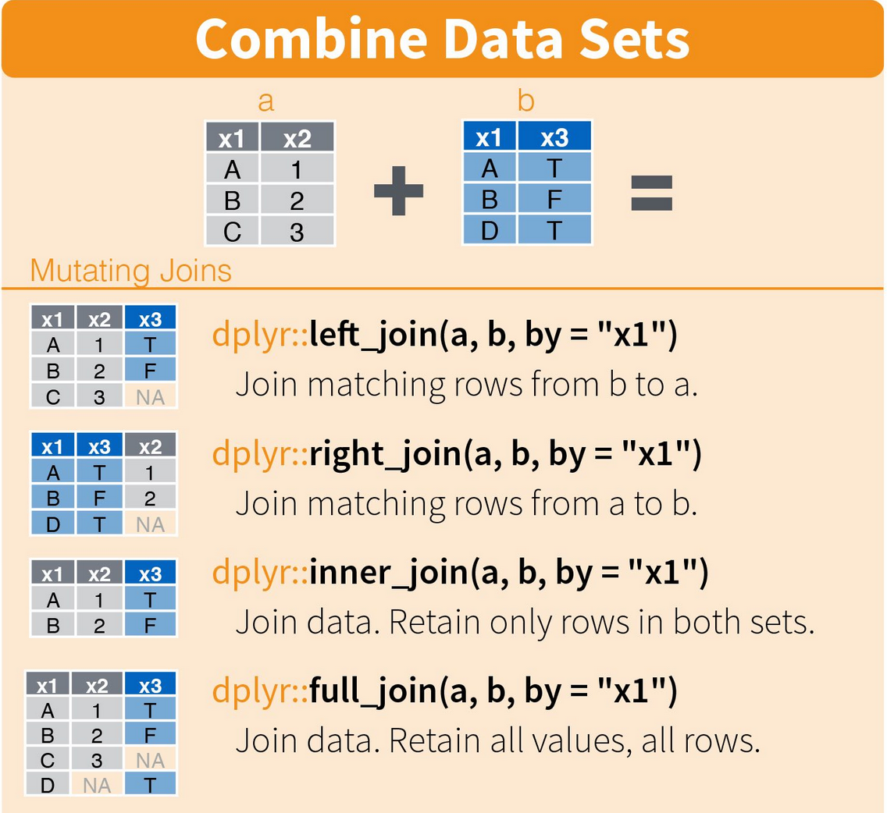
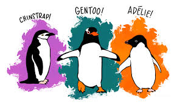
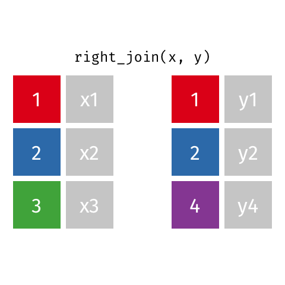
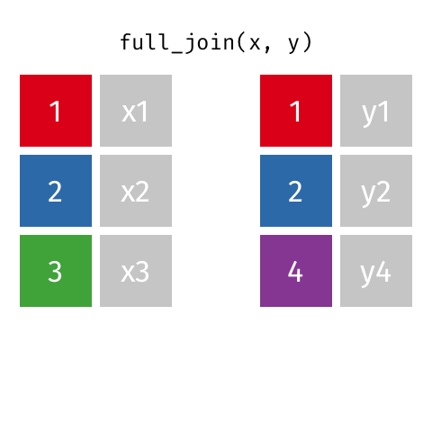
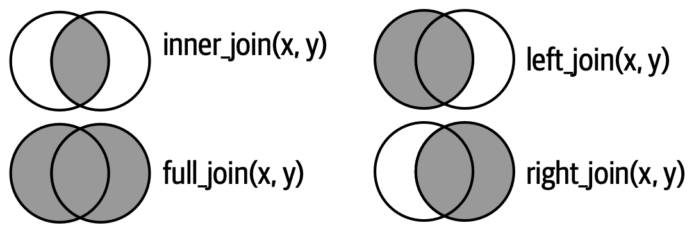

```{r setup, include = FALSE}
knitr::opts_chunk$set(echo = TRUE, warning = FALSE, message = FALSE, include = TRUE)
```

## Objetivos Tema3: Flujo y control

-   Organizando datos: gramática de datos (📝)

-   Visualización de datos: ggplot (🧑‍🎓 )

### Gramática de datos

En el tema anterior trabajamos con las funciones `filter()` / `slice()` y `select()` y `rename()`. En este tema vamos a trabajar con el resto de funciones básicas de `dplyr`.

`distinct`: filtra por filas únicas.

`mutate`: operaciones con variables, añadiendo nuevas.

`summarise`: reduce variables a valores (estadísticas).

`group_by`: operaciones que requieren agrupación.

### Transformar los datos y calcular nuevas variables

#### [Mutate](https://dplyr.tidyverse.org/reference/mutate.html): crear, modificar o eliminar columnas

Primero, volvemos a leer la base de datos de tidytuesday de **cousine**; despues:

-   generamos una nueva variable que contiene un identificador único,

-   una nueva variable que sea n valor del número de usuarios que han valorado una receta, pero no han escrito una reseña o comentario (i.e. número de reseñas al numero total de valoraciones).

-   redefinir `servings` considerando los niveles del factor, cambiando de `1`, `2` y `3` a `una_persona`, `dos_personas` y `tres_personas`.

```{r ejemplo-mutate}

library(tidyverse) 

recetas <- read_delim(file = "data/cuisines.csv", 
                      delim = ",")  
# con el argumento col_type puedo especificar el tipo de dato (en este caso country como factor) 

recetas <- read_delim(
  file = "data/cuisines.csv",
  delim = ",",
  col_type = list(country = "f", servings = "f")
)  

recetas   
summary(recetas) 

# definir una variable   
recetas |>
  mutate(
    # desde cero
    ID = 1:nrow(recetas),
    # utilizando una variable para calcular otra (ej.nº personas con puntuación cero)
    num_ratings_no_review = total_ratings - reviews) |>
    select(ID, 
          name:date_published, 
          total_ratings,
          reviews,
          num_ratings_no_review,
          everything() #añade todas las columnas restantes, sin duplicar las ya seleccionadas.
        )

# sobreescribir una variable.
recetas |>
  mutate(
  # fct_recode sirve para redefinir los niveles de un factor (ojo                  sintaxis:new_name = "old_name")
    servings = fct_recode(
      servings,
      una_persona = "1" ,
      dos_personas = "2",
      tres_personas = "3" 
      ))

#utilizar mas de una variable para generar otra
recetas |>
  mutate(
    classification = case_when(
      # utilizar varias variables para calcular otra nueva
      avg_rating > 4 &
        country %in% c(
          "Chilean",
          "Brazilian",
          "Peruvian",
          "Cuban",
          "Puerto Rican",
          "Colombian"
        )  ~ "highest‑rated_Latin_cuisine",
      
      avg_rating < 2 &
        country %in% c(
          "Chilean",
          "Brazilian",
          "Peruvian",
          "Cuban",
          "Puerto Rican",
          "Colombian"
        )  ~ "lowest‑rated_Latin_cuisine",
      
      TRUE ~ "others" #resto de casos
    )
  )


# Podemos hacer todo lo anterior concatenando todo el proceso y guardar el set de datos:

recetas_modif <- recetas |>
  mutate(
    ID = 1:nrow(recetas),
    
    num_ratings_no_review = total_ratings - reviews,
    
    servings = fct_recode(
      servings,
      una_persona = "1" ,
      dos_personas = "2",
      tres_personas = "3")
  )


recetas_modif <- recetas |>
  mutate(
    ID = 1:nrow(recetas),
    
    num_ratings_no_review = total_ratings - reviews,
    
    servings = fct_recode(
      servings,
      una_persona = "1" ,
      dos_personas = "2",
      tres_personas = "3"),
    
    classification = case_when(
      # utilizar varias variables para calcular otra nueva
      avg_rating > 4 &
        country %in% c(
          "Chilean",
          "Brazilian",
          "Peruvian",
          "Cuban",
          "Puerto Rican",
          "Colombian")  ~ "highest‑rated_Latin_cuisine",
      
      avg_rating < 2 &
        country %in% c(
          "Chilean",
          "Brazilian",
          "Peruvian",
          "Cuban",
          "Puerto Rican",
          "Colombian")  ~ "lowest‑rated_Latin_cuisine",
      
      TRUE ~ "others" #resto de casos
    )
  )
```

------------------------------------------------------------------------

#### 📝 *Ejercicio: mutate()*

+---------------------------------------------------+----------------------------------------------------------------------------------------------------------------------------------------------------------------------------------------------------------------------------------------------------------------------------------------------------------------------+
|  | -   Con el data set de msleep, incluye una nueva columna con el porcentaje de horas que duerme cada animal al día.                                                                                                                                                                                                   |
|                                                   |                                                                                                                                                                                                                                                                                                                      |
|                                                   | -   Haz una clasificación que incluya tres categorías: carnivoros amenazados, herviboros amenazados y otros. Para ello tienes que basarte en las columnas “vore” y “conservation”. Segun la UICN se considera amenazado cuando está en las categorías vulnerable (vu), endangered (en) o critically endangered (cd). |
+---------------------------------------------------+----------------------------------------------------------------------------------------------------------------------------------------------------------------------------------------------------------------------------------------------------------------------------------------------------------------------+

#### [Summarise](https://dplyr.tidyverse.org/reference/summarise.html) y [group by](https://dplyr.tidyverse.org/reference/group_by.html): generar un nuevo `data.frame` resumiendo cada grupo a una fila

```{r cousine-summarise}

# mínimo y máximo tiempo de preparación
recetas |> 
  summarise(prep_time_max = max(prep_time),
            prep_time_total_min = min(prep_time))

# minimo, máximo y media de proteínas de todas las recetas
recetas |> 
  summarise(protein_max = max(protein),
            protein_mean = mean(protein),
            protein_min = min(protein))

 ## Ojo! si no queremos que tenga en cuenta los NA hay que añadir argumento na.rm = T
recetas |> 
  summarise(protein_max = max(protein, na.rm = T),
            protein_mean = mean(protein, na.rm = T),
            protein_min = min(protein, na.rm = T))
```

¿Cómo podríamos hacer lo mismo por país? Esta es una operación muy común gestionando datos: revisalo en la chuleta de dplyr.

```{r cousine-group_by}

#Lo mismo que antes, pero por país
recetas |> 
  group_by(country) |>
  summarise(protein_max = max(protein, na.rm=T),
            protein_mean = mean(protein, na.rm=T),
            protein_min = min(prep_time, na.rm=T))

```

#### 📝 *Ejercicio: group_by(), summarise()*

+---------------------------------------------------+-------------------------------------------------------------------------------------------------------------------------------------------------------------------+
|  | -   Con el data set de msleep, cuenta el número de especies estudiadas por orden (order)                                                                          |
|                                                   |                                                                                                                                                                   |
|                                                   | -   Calcula el promedio de horas de sueño según el tipo de alimentación ¿duemen mas los carnivoros, los herbívoros o los insectívoros estudiados en este dataset? |
+---------------------------------------------------+-------------------------------------------------------------------------------------------------------------------------------------------------------------------+

### [Pivot](https://tidyr.tidyverse.org/reference/pivot_longer.html): transformar datos a formato largo o ancho

Nos permite transformar datos de formato largo a ancho y viceversa. Nos puede convenir una forma u otra según lo que queramos hacer con lo datos: presentarlos en una tabla, hacer transformaciones o análisis, hacer un gráfico etc.

En la siguiente imagen, extraída de [The Epidemiologist R Handbook](https://www.epirhandbook.com/en/) se puede ver en qué consiste esta transformación.

{fig-align="center" width="555"}

```{r cousine-pivot}

recetas_Vietnam<- recetas |>  
  select(name, country, fat, carbs,protein) |>  
  filter(country == "Vietnamese")

# transformamos a formato largo, incluyendo los valores de grasas, carbohidratos y proteinas en una columna llamada "nutritional_value

recetas_Vietnam_long <- recetas_Vietnam |> 
  pivot_longer(cols = fat:protein, 
               names_to = "nutritional_value")

#volvemos al set original

recetas_Vietnam_wide <- recetas_Vietnam_long |> 
  pivot_wider(names_from = nutritional_value, 
              values_from = value)
```

#### 📝🚀 *Ejercicio extra: transformar datos largo ancho*

+-------------------------------------+--------------------------------------------------------------------------------------------------------------------------------------------------------------------------------------------------------------------+
|  | -   Lee el set de datos pixar_public_response_long. En este set de datos se encuentra la puntuación de películas pixar por la audiencia según tres webs diferentes: rotten tomatoes, metacritic y critics’ choice. |
|                                     |                                                                                                                                                                                                                    |
|                                     | -   Reorganiza el set de datos para que la puntuación de cada una de las webs se encuentre en una columna diferente                                                                                                |
|                                     |                                                                                                                                                                                                                    |
|                                     | -   (extra) ¿Cual es el promedio de puntuación por película teniendo en cuenta todas las fuentes? ¿Que película es la mejor y peor puntuada de media?                                                              |
+-------------------------------------+--------------------------------------------------------------------------------------------------------------------------------------------------------------------------------------------------------------------+

Fuente imagen: <https://www.flickr.com/photos/harshlight/17294952412> (CC BY 2.0)

### Unir data.frames: [joins](https://dplyr.tidyverse.org/reference/mutate-joins.html)

`*_join()` añade columnas de `y` (segundo data.frame) a `x` (primer data.frame), haciendo coincidir las observaciones en función de la variable común.

{width="559"}

```{r cousine-joins}


# join: left, right, full, inner

#datos de pais - capital- continente
paises <- tibble(
  pais = c("España", "Francia", "Japón", "Brasil", "Sudáfrica"),
  capital = c("Madrid", "París", "Tokio", "Brasilia", "Pretoria"),
  continente = c("Europa", "Europa", "Asia", "América", "África")
)

#datos demográficos
demografia <- tibble(
  pais = c("España", "Japón", "Brasil", "Canadá", "Sudáfrica"),
  poblacion_millones = c(47.4, 125.7, 203.1, 39.6, 60.0),
  extension_km2 = c(505990, 377975, 8515767, 9984670, 1221037)
)

#left join: se une al set de datos de pais los datos de demografia (si los hay)
left_join(paises, demografia, by = "pais")

#right join: se une al set de datos de demografa los datos de pais (si los hay)
right_join(paises, demografia, by = "pais")

#inner join: une los paises presentes en los dos set de datos
inner_join(paises, demografia, by = "pais")

#full join: une todos los paises presentes en uno u otro.
paises_demo_full_join <- full_join(paises, demografia, by = "pais")
```

### Guardar datos con [Write_delim](https://readr.tidyverse.org/reference/write_delim.html):

```{r cousine-export}

write_delim(paises_demo_full_join, 
            file = "resultados/paises_demo_full_join.csv",
            delim = ";")

```

#### 📝🚀 *Ejercicio: \*\_join() y exportar datos*

+----------------------------------------------------------------------------------------------------+---------------------------------------------------------------------------------------------------------------------------------+
|  | -   Lee el set de datos pixar_public_response y pixar_films                                                                     |
|                                                                                                    |                                                                                                                                 |
|                                                                                                    | -   Explora los dos data sets con funciones como head() para ver las primeras lineas, glimpse() o View()                        |
|                                                                                                    |                                                                                                                                 |
|                                                                                                    | -   Une ambos datasets en uno solo para tener en un mismo data frame toda la información. Elige el campo más apropiado de unión |
|                                                                                                    |                                                                                                                                 |
|                                                                                                    | -   Guarda el nuevo set de datos como pixar_joint                                                                               |
+----------------------------------------------------------------------------------------------------+---------------------------------------------------------------------------------------------------------------------------------+

## Trabajando con palmerpenguins

Siempre vamos a trabajar con la pipa, y el primer argumento será una base de datos. Después tenemos que saber las **operaciones *qué queremos hacer***, para obtener una determinada base de datos de *salida*. Para todo el trabajo en esta sesión vamos a trabajar con la base de datos ***palmerpenguins*** que está disponible en el paquete palmerpenguins.

*¿Qué contiene?* Datos sobre tres especies de pingüinos (Adelie, Chinstrap y Gentoo) de las islas Palmer. Fue creasdo por Dr. Kristen Foram, Dr. Allinson Horst y Dr. Alison Hill, para exploración y visualización de datos.



Artwork by @allison_horst.

```{r load-palmerpenguins}
library(palmerpenguins) 
library(tidyverse) 
glimpse(penguins) 
```

### Trabajando con un data.frame

Selecciona la variable especies, aquellas que empiecen por "bill" y el sexo.

```{r select-palmerpenguins}
penguins |>
   select(species, starts_with("bill_length_mm"), sex)
```

Hay una serie de funciones que pueden ayudar a seleccionar (ver en el power point), posteriormente lo disponemos en **orden desdencente** por la produndidad del pico.

```{r arrange-palmerpenguins}
penguins |>
  select(species, bill_depth_mm, sex) |>
  arrange(desc(bill_depth_mm)) |>
  head()
```

Si en vez de *ver* las seis primeras filas, queremos **seleccionarlas**, podemos usar la función *slice* que selecciona filas basads en su posición. El uso de *slice* es más común en tidyverse y especialmente después de agrupar.

```{r slice-palmerpenguins}
penguins |>
  select(species, bill_depth_mm, sex) |>
  arrange(desc(bill_depth_mm)) |>
  slice(1:6)
```

En este caso no hay ninguna diferencia con el anterior, pero si quisieramos las **tres primeras filas de cada especie** podriamos hacer lo siguiente. Hay variaciones muy interesantes como tenéis en el power point asociado.

```{r group-palmerpenguins}

penguins |>
  select(species, bill_depth_mm, sex) |>
  group_by(species)|>
  arrange(desc(bill_depth_mm)) |>
  slice(1:3)
```

Imaginate que en este caso queremos únicamente tener dos especies de las tres. En este caso podemos filtrar por múltiples condiciones:

```{r filter-palmerpenguins}
penguins |>
  select(species, bill_depth_mm, sex) |>
  filter(species %in% c("Adelie", "Gentoo"),
         sex == "female") |>
  group_by(species)|>
  arrange(desc(bill_depth_mm)) |>
  slice(1:3)
```

Vamos a ver cómo **contar** el número de individuos muestreados, con la funcion "count"

```{r count-palmerpenguins}
penguins |>
  select(species, bill_depth_mm, sex) |>
  filter(species %in% c("Adelie", "Gentoo"),
         sex == "female") |>
  group_by(species)|>
  count()
```

Ahora, vamos a calcular la **media del tamaño del pico y la desviación estandar por especie**, añadiendolo a lo anterior con la función summarise(). Por favor, chequea que entiendes cómo **summarise** cambia la estructura del data.frame ya que colapsa las filas a cada valor dentro del "group_by" y remueve las columnas que son irrelevantes en el cálculo. Cuando se genera una nueva columna no es obligatorio pero es *MUY RECOMENDABLE* nombrarla con un estilo y sintaxis adecuado.

```{r summarise-palmerpenguins}
penguins |>
  select(species, bill_depth_mm, sex) |>
  filter(species %in% c("Adelie", "Gentoo"),
         sex == "female") |>
  group_by(species)|>
  summarise(num_inds   = n(),
            mean_depth = mean(bill_depth_mm),
            sd_depth   = sd(bill_depth_mm)) 
```

------------------------------------------------------------------------

#### 📝 **📤**Ejercicio: calcula estadisticas y ordena. Envia "`3.1.summary_spp_sex.csv`" a través del aula virtual

Realiza los siguientes pasos:

(1) Selecciona el data.frame `penguins`, y calcula con `mutate` dos nuevas variables que son la longitud y la profundidad del pico en metros. Guardalo en el df `penguins`.

(2) Para cada especie calcula el numero de individuos hembras y machos.

(3) Para los machos y hembras para cada especie calcula la media, el maximo, el mínimo y la desviación estandar de la longitud y profundidad del pico.

(4) Exporta la tabla en la carpeta "resultados" nombrando a la tabla como `3.1.summary_spp_sex.csv`

------------------------------------------------------------------------

### Trabajando con un varios data frames: bases de datos y uniones

Imaginate que tenemos información adicional sobre las especies, pero solo a nivel de especie, que es *la edad promedio de reproducción* y queremos traerlo a este data.frame ¿cómo podríamos unir ambas bases de datos?

Antes de ponder realizar uniones tienes que poder entender qué es un identificador o **llave** tal y como se usa en el lenguaje de base de datos. Normalmente se trabajan con bases de datos que son un conjunto de tablas que se *relacionan* entre si. Cuando trabajes con datos tienes que entender cada **tabla** y como son las relaciones entre las tablas, para poder hacer uniones cuando lo necesites. Cada tabla tiene que tener un **identificador único** y si en tu base de datos tienes varias tablas que se relacionan entre si debes conocer y chequear las relaciones.

```{r creando-edad}
edad_repro <- data.frame(
  species = c("Adelie", "Chinstrap", "Gentoo"),
  edad_reproduccion = c(3.5, 4.0, 5.0)
)
```

Unimos ambas bases de datos:

```{r uniendo-edad-penguins}
penguins_joined <- penguins |>
  left_join(edad_repro, by = "species")
```

Inspeccionamos el resultado:

```{r select-edad-penguis}
penguins_joined |>
  select(species, sex, body_mass_g, edad_reproduccion) |>
  head()
```

Como resultado el **left_join** mantiene todas las filas de la izquiera, pero *¿habría dado el mismo resultado con un right_join o full_join?*


Si hubieramos hecho un *right join* no hubiera sido el mismo resultado... Además, tenemos que considerar cual es el "identificador" de cada base de datos.



En ocasiones nos puede interesar realizar uniones completas con **full_join**, en ese caso se mantendrían todas las filas de ambas bases de datos, poniendo NAs si no tiene información disponible.



También podríamos hacer un **inner_join** si queremos que mantenga únicamente los identificadores que están en ambas bases de datos.


A modo resumen, aquí tienes **todos los tipos de uniones**.



Os mostramos en línea para practicar manipulación y transformación de datos en R, especialmente con el **ecosistema tidyverse**. Cada enlace incluye ejercicios, datasets y explicaciones paso a paso.

------------------------------------------------------------------------

[R for Data Science (Capítulo 3: Data transformation)](https://r4ds.hadley.nz/data-transform.html)

Guía oficial del libro *R for Data Science* (2ª edición).\
Incluye ejemplos detallados sobre los verbos principales de `dplyr`:\
`filter()`, `mutate()`, `arrange()`, `summarise()`, `group_by()` y `join()`.

------------------------------------------------------------------------

[Learn the tidyverse – sitio oficial](https://www.tidyverse.org/learn/)

Portal oficial del *tidyverse*, con tutoriales, documentación y materiales de aprendizaje.\
Ofrece enlaces a recursos de `dplyr`, `ggplot2`, `tidyr`, `stringr`, `forcats`, etc.

------------------------------------------------------------------------

[Interactive Tutorials • learnr](https://rstudio.github.io/learnr/)

Herramienta para crear y realizar **tutoriales interactivos** ejecutables dentro de RStudio.

------------------------------------------------------------------------

\###[TidyTuesday – práctica libre con datos reales](https://github.com/rfordatascience/tidytuesday?tab=readme-ov-file) Proyecto abierto con **datasets semanales**. Permite practicar todo el flujo tidyverse.
