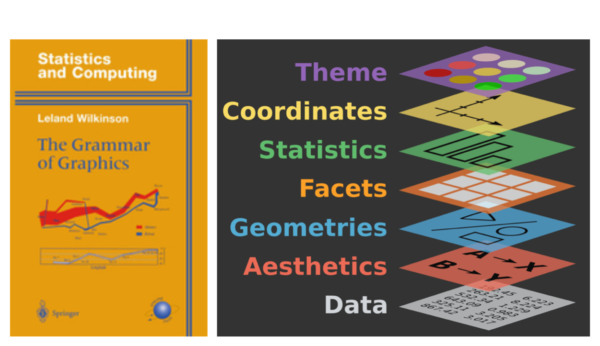
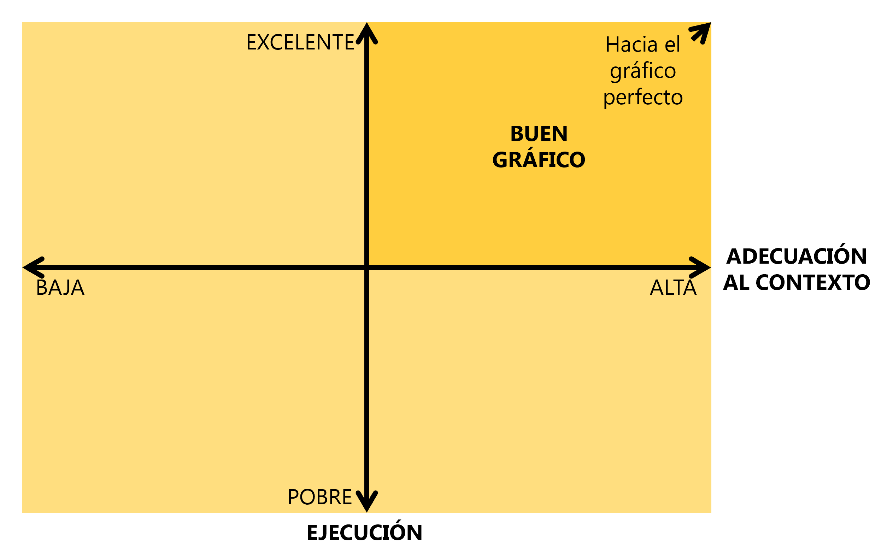
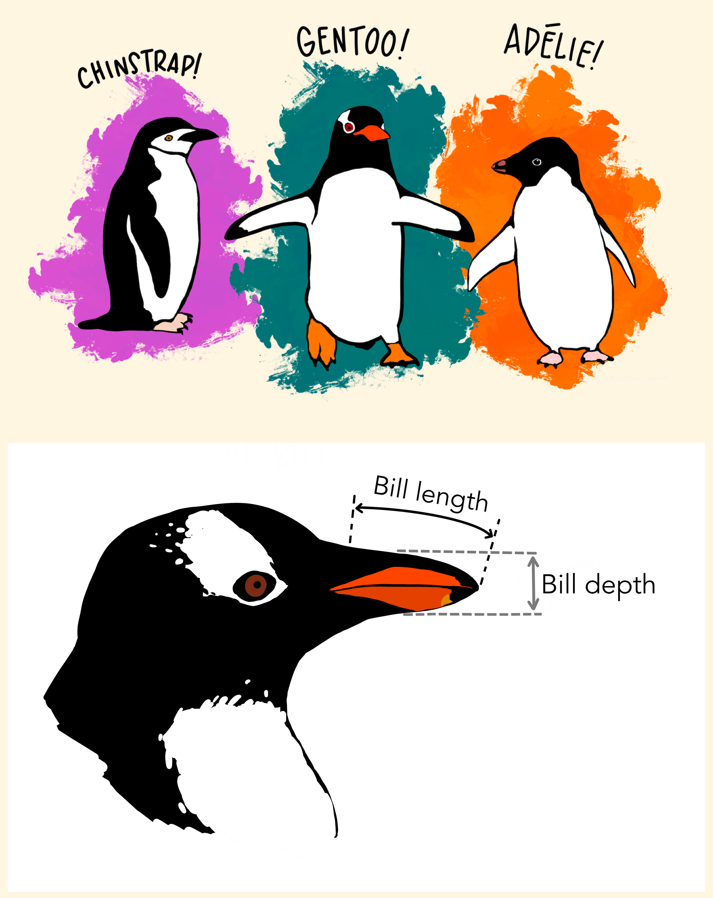

```{r setup, include = FALSE}
knitr::opts_chunk$set(echo = TRUE, warning = FALSE, message = FALSE, include = TRUE)
```

## Objetivos Tema3: Flujo y control

-   Organizando datos: gramática de datos (📝)

-   Visualización de datos: ggplot (🧑‍🎓 )

# Los básicos: datos y la estética del gráfico.

**`ggplot2`** es uno de los paquetes más utilizados en *R* para la visualización de datos dentro del ecosistema tidyverse, un conjunto de paquetes diseñados para trabajar con datos de forma coherente, eficiente y reproducible. **`gplot2`** se basa en la *Grammar of Graphics*, una filosofía que entiende los gráficos como la combinación de componentes bien definidos: los datos, las variables que se representan (*aesthetics*), las formas geométricas que las visualizan, las escalas y el contexto visual. Esta lógica resulta especialmente útil en áreas donde se manejen una gran cantidad de información, donde usualmente se trabaja con datasets multidimensionales, heterogéneos y, a menudo, espaciales o temporales.



En lugar de “dibujar” un gráfico de una sola vez, **`ggplot2`** nos invita a construirlo por capas, añadiendo información de manera progresiva. Este enfoque favorece la exploración de los datos, permite modificar y reutilizar gráficos con facilidad. Un mismo conjunto de datos puede representarse de múltiples maneras simplemente cambiando una capa o una estética, lo que resulta ideal para comparar escenarios, periodos temporales o gradientes ambientales.

¿Qué hace que una visualización de un gráfico sea buena? No depende ñunicamente de que sea visualmente atractivo, sino de dos dimensiones fundamentales:

-   La **EJECUCIÓN**, es decir, cómo de bien construido está el gráfico desde el punto de vista técnico y visual (claridad, legibilidad, coherencia), y

-   La **ADECUACIÓN**, que responde a preguntas clave como qué queremos comunicar, a quién va dirigido, con qué objetivo y en qué contexto se va a utilizar.

{width="441"}

Primero de todo, tenemos que realizar la **instalación y carga los paquetes necesarios** si aún no los tenemos. Vamos a seguir trabajando con los datos de Palmer Penguins. Donde tenemos las medidas de especies de pinguimos de la Isla de Palmer.

```{r info-paquetes}
library(palmerpenguins) 
library(tidyverse) 
library(GGally) 
glimpse(penguins) 
```

La visualización exploratoria de datos es una etapa fundamental en cualquier análisis . Una visualización bien construida debe ser clara, tener ejes etiquetados apropiadamente, incluir un título descriptivo, una leyenda legible cuando sea necesario, y siempre indicar las unidades de medida. El paquete `ggplot2` implementa la *Grammar of Graphics* (Gramática de los Gráficos), un sistema coherente y estructurado para construir visualizaciones de nuestros datos. Esta gramática se compone de varios elementos fundamentales: **datos** + **aesthetics** + **geometrías** + **opciones adicionales**, que se combinan de forma modular para crear gráficos complejos.

Antes de construir gráficos con **`ggplot2`**, es esencial entender los tres componentes fundamentales que definen cualquier visualización creada con este paquete. Estos componentes siguen una lógica específica y se combinan de manera sistemática:

1.  **Datos (`data`)**: indicamos qué datos queremos mostrar.

2.  **Aesthetics (`aes`)**: definimos cómo se relacionan las variables con las características visuales del gráfico (posición, color, tamaño, forma…).

3.  **Geometrías (`geom`)**: definimos el tipo de gráfico que queremos dibujar (puntos, líneas, barras, cajas, etc.).

Esta estructura constituye la **Gramática de los Gráficos**, que proporciona un marco consistente y flexible para crear visualizaciones de nuestros datos.

Todas las capas se conectan entre sí con el símbolo `+`. Es importante colocarlo **al final de la línea** si queremos seguir añadiendo capas al gráfico.

💡 Nota: se utiliza `+` en lugar del pipe (`|>` ó `%>%`) porque `ggplot2` fue desarrollado antes de su popularización y cambiarlo requeriría ajustar muchos paquetes.

La sintaxis general para crear un gráfico en **`ggplot2`** sigue este patrón:

> ggplot(**datos**(data = data), **aes**(x = var_1, y = var_2)) +
>
> **geometría** (geom\_) +
>
> **opciones_adicionales**

Creamos un histograma para visualizar la distribución de la longitud del pico de los pingüinos.

```{r histograma}

ggplot(data = penguins, aes(x = bill_length_mm)) +   
  geom_histogram(binwidth = 1, fill = "steelblue", color = "black") +  
  labs(title = "Ejemplo de gráfico usando ggplot",         
       x = "Longitud del pico (mm)")
```

La función `ggplot()` inicializa el sistema de gráficos y establece el marco de trabajo. Por sí sola, no produce ninguna visualización, sino que crea un "lienzo vacío" sobre el cual construiremos el gráfico. Es necesario especificar al menos un conjunto de datos para que funcione correctamente.

Al ejecutar solo `ggplot(data = penguins)`, obtenemos un panel vacío porque no hemos definido qué variables representar ni cómo visualizarlas.

```{r lienzo}
#| fig-cap: "Lienzo en blanco. Aún no hemos comenzado a representar nada. Únicamente le hemos dicho a RStudio que queremos visualizar algo" 
ggplot(data = penguins)
```

La función *aes(),* abreviatura de "aesthetics", define las asignaciones estéticas, es decir, cómo se relacionan las variables del conjunto de datos con las propiedades visuales del gráfico. Dentro de *aes()* podemos especificar:

-   **x**: Variable para el eje horizontal

-   **y**: Variable para el eje vertical

-   **color**: Variable que determina el color de los elementos

-   **fill**: Variable que determina el color de relleno

-   **size**: Variable que determina el tamaño de los elementos

-   **shape**: Variable que determina la forma de los elementos

-   **alpha**: Variable que determina la transparencia

En el siguiente código, asignamos la especie de pingüino al eje X, pero aún **no especificamos ninguna geometría** para representar visualmente estos datos.

```{r aes-1, echo = TRUE}
#| fig-cap: "Variables añadidas pero sin representar aún la geometría"
 ggplot(data = penguins, 
        aes(x = species)) 
```

Aquí estamos diciendo: eje X → Especie de pingüino (*species*). Por ahora seguimos sin dibujar nada, pero **el gráfico ya sabe qué representar**.

Las **geometrías** (funciones que comienzan con `geom_`) son las capas que realmente dibujan elementos en el gráfico. Cada tipo de gráfico corresponde a una geometría específica. La elección de la geometría depende del tipo de datos y del mensaje que queremos comunicar.

Algunos ejemplos de geometrías:

| Geometría          | Tipo de gráfico            |
|--------------------|----------------------------|
| `geom_point()`     | Gráfico de dispersión      |
| `geom_line()`      | Gráfico de tendencia       |
| `geom_bar()`       | Gráfico de barras          |
| `geom_histogram()` | Histogramas                |
| `geom_boxplot()`   | Gráfico de cajas y bigotes |

: Ahora añadimos una geometría (`geom_bar`) de barras al gráfico anterior para crear un gráfico que nos muestre el número de ejemplares que tenemos de cada especie de pingüino en nuestra base de datos.

```{r geom_bar, echo = TRUE}
#| fig-cap: "Representación del conteo de individuos por especie en nuestra base de datos" 
ggplot(penguins, aes(x = species)) +   
   geom_bar() 
```

------------------------------------------------------------------------

#### 📝Ejercicio: Creación de gráficos

Crea dos gráficos: uno que muestre el número de individuos por especie y otro el número de individuos por isla. Crea otro gráfico con la variable *body_mass_g* que muestre la distribución de la variable.

-   ¿Qué diferencias observas entre representar una variable categórica y una variable continua?

-   ¿Qué aspectos del gráfico mejorarías para hacerlo más claro?

    ------------------------------------------------------------------------

## Los básicos y los avanzados: la estética vs. el mapeado, facetas

El **mapping** determina el tamaño, la transparenciad e los puntos basados en los valores de la variable especificada, y lo especificamos dentro del argumento `aes()`.

El **setting** determina el tamaño, la transparencia, etc. sin basarse en los valores de la variable especificada. En este caso va en la función `geom_poing` (pero puede ser del tipo `geom_*()` porque aprenderemos más formas a lo largo de la visualización).

### Etiquetas (`labs()`)

Las etiquetas son elementos fundamentales para mejorar la claridad y comprensión de los gráficos. La función `labs()` nos permite personalizar todos los textos descriptivos de un gráfico, haciéndolo autónomo y comprensible sin necesidad de referencias externas. Es crucial para crear visualizaciones profesionales que puedan ser interpretadas correctamente fuera de su contexto original, por ejemplo en una presentación de ppt.

Comenzamos creando un gráfico base de diagramas de caja que relaciona la especie de pingüinos con su masa corporal. Este gráfico servirá como punto de partida para demostrar cómo las etiquetas mejoran la comunicación de la información.

```{r grafico}
# Gráfico base 
penguins_boxplot <- ggplot(data = penguins) +    
  geom_boxplot(aes(x = species, y = body_mass_g))  

penguins_boxplot
```

Ahora aplicamos la función `labs()` para añadir todos los elementos textuales necesarios: título principal, subtítulo contextual, etiquetas descriptivas para ambos ejes y un pie de figura que indica la fuente de los datos.

```{r grafico-2} # Añadir etiquetas descriptivas}

penguins_boxplot  +    
  labs(title = "Masa corporal de los pingüinos por especie",     
       subtitle = "Datos de las tres islas",     
       x = "Especie",     y = "Masa corporal (g)",     
       caption = "Fuente: palmerpenguins")
```

La función `labs()` permite personalizar los textos del gráfico. Es crucial para hacer los gráficos autónomos y comprensibles.

### Sistema de coordenadas

Por defecto, `ggplot2` usa coordenadas cartesianas, pero ofrece flexibilidad para ajustar la vista de los datos. **Es importante distinguir entre hacer zoom (manteniendo todos los datos) y limitar el rango (eliminando datos fuera del rango).**

La función `coord_cartesian()` permite enfocar en una región específica del gráfico **sin descartar observaciones**.

```{r coordenadas}
# Zoom en el eje Y 
penguins_boxplot +   
  coord_cartesian(ylim = c(2000, 4500))
```

En contraste, cuando se usan límites directamente en la escala (`scale_*_continuous()` o `xlim()/ylim()`) se descartan los datos que quedan fuera del rango especificado:

```{r coordenadas 2}
# Límite en escala que SÍ descarta datos (observaciones fuera de 2000-6000 se eliminan) 
penguins_boxplot +   
  scale_y_continuous(limits = c(2000, 4500))  

# Equivalente usando ylim() - también descarta datos 

penguins_boxplot +   
  ylim(2000, 4500)
```

⚠️ Advertencia: Cuando se usan límites en escalas, `ggplot2` mostrará una advertencia indicando que se han eliminado observaciones.

Comparación práctica:

`coord_cartesian(ylim = c(2000, 4500))`: **Mantiene todos los datos, solo ajusta la vista**

`scale_y_continuous(limits = c(2000, 4500))` o `ylim = (2000, 4500)`: **Filtra y elimina datos fuera del rango**

Esta diferencia es crucial cuando se usan estadísticos como regresiones o suavizados, ya que al descartar datos se afectan los cálculos de tendencias y modelos.

------------------------------------------------------------------------

#### 📝 Ejercicio: Diagrama de cajas con etiquetas completas

Crea un gráfico **boxplot** de longitud de la aleta por especies de pingüinos. Añade **etiquetas completas** usando `labs()`:

-   Título principal: “Distribución de masa corporal por especie”

-   Subtítulo: “Datos del estudio Palmer Penguins”

-   Eje X: “Especie de pingüino”

-   Eje Y: “Longitud de la aleta (mm)”

-   Pie de figura: “Fuente: palmerpenguins”

Preguntas:

-   ¿Por qué es importante incluir todas estas etiquetas en un gráfico que será mostrado fuera de contexto?

-   ¿Qué aporta el subtítulo respecto al título?

Ajusta las coordenadas / zoom, usando las siguientes instruccioens:

1.  Aplica `coord_cartesian()` para enfocar la vista entre **180 y 200mm** en el eje Y.

2.  Crea un segundo gráfico usando `ylim(180, 200)`.

3.  Compara los resultados y observa la diferencia.

**Preguntas de reflexión:**

-   ¿Qué sucede con los puntos fuera del rango cuando usamos `coord_cartesian()` vs `ylim()`?

-   ¿Por qué podría ser problemático usar `ylim()` si más adelante añadimos suavizados o regresiones?

    ------------------------------------------------------------------------

### Faceting

En el análisis de datos, a menudo no solo nos interesa estudiar la relación entre dos variables, sino también **cómo cambia esa relación entre distintos grupos** (por ejemplo, entre islas, sexos o especies). Representar todos los datos juntos puede ocultar patrones importantes.

El **faceting** es una técnica de `ggplot2` que permite **dividir un mismo gráfico en varios paneles**, de modo que cada panel muestra un subconjunto de los datos, manteniendo una estructura visual común. Esto facilita la **comparación directa entre grupos**.

#### Gráfico base

Antes de aplicar faceting, es fundamental construir un **gráfico base** que represente correctamente la relación que queremos analizar. En este ejemplo, estudiaremos la relación entre la masa corporal y la longitud de la aleta de los pingüinos, diferenciando las especies mediante color.

```{r facets}
penguins_plot <- ggplot(   
  data = penguins,   
  aes(     
    x = body_mass_g,     
    y = flipper_length_mm,     
    color = species   
    ) ) +   
  geom_point(na.rm = TRUE)  

penguins_plot
```

Este gráfico muestra **todos los individuos juntos**. Permite observar la tendencia general, pero no facilita la comparación entre grupos específicos como islas o sexos.

#### Faceting por una variable categórica

Para analizar si la relación entre masa corporal y longitud de aleta varía según la isla, podemos dividir el gráfico en varios paneles, uno por cada isla. Esto se consigue con `facet_wrap()`.

```{r facets-2} # Facet en filas}

penguins_plot +   
  facet_wrap(vars(island))  

penguins_plot +   
  facet_wrap(~island)
```

Cada panel contiene únicamente los datos correspondientes a una isla, pero todos comparten los mismos ejes. Esto permite comparar visualmente las distribuciones y relaciones entre islas de forma clara y directa.

Este tipo de faceting es especialmente útil cuando se quiere estudiar **un único factor categórico**.

#### Faceting estructurado: filas y columnas con `facet_grid()`

Cuando queremos estudiar simultáneamente **dos variables categóricas**, `facet_grid()` permite organizar los paneles en una rejilla definida por filas y columnas.

En el siguiente ejemplo, los datos se separan por especie (filas) e isla (columnas):

```{r facets-3}

penguins_plot +   
  facet_grid(rows = vars(species), 
             cols = vars(island))  

penguins_plot +   
  facet_grid(species ~ island)
```

Cada panel representa una combinación concreta de sexo e isla. Este enfoque es muy potente para detectar interacciones entre factores, aunque puede generar un número elevado de paneles y resultar más complejo de interpretar para usuarios principiantes.

#### `facet_wrap()` frente a `facet_grid()`

Aunque ambas funciones crean múltiples paneles, tienen usos distintos:

-   `facet_grid()` se utiliza cuando queremos **controlar explícitamente** la disposición en filas y columnas.

-   `facet_wrap()` es más flexible y se adapta mejor cuando una variable categórica tiene muchos niveles.

    Por ejemplo, una representación más compacta por especie sería:

```{r facets-4}

# Facet wrap (organiza en rejilla) 

penguins_plot +    
  facet_wrap(facets = vars(species), ncol = 3)
```

#### Comparación visual: sin faceting vs con faceting

Sin faceting, el gráfico muestra una visión global, pero dificulta responder preguntas como:

-   ¿La relación entre masa corporal y longitud de aleta es igual en todas las islas?

-   ¿Hay islas con mayor variabilidad?

El faceting no añade datos nuevos, pero **organiza la información de forma que estas comparaciones sean más evidentes**.

#### Escalas fijas y escalas libres

Por defecto, todos los paneles utilizan la misma escala en los ejes, lo que facilita la comparación entre grupos.

```{r facets-5}
penguins_plot +   
  facet_wrap(vars(island))
```

Sin embargo, en algunos casos puede ser útil permitir que cada panel tenga su propia escala:

```{r facets-6}

penguins_plot +   
  facet_wrap(vars(island), scales = "free")
```

-   **Escalas fijas**: recomendadas cuando se quiere comparar valores entre grupos.

-   **Escalas libres**: útiles para explorar la variabilidad interna de cada grupo, aunque dificultan la comparación directa.

    #### Idea clave

    > El faceting permite comparar grupos sin cambiar el diseño del gráfico.\
    > No crea gráficos diferentes, sino distintas “ventanas” de la misma visualización.

------------------------------------------------------------------------

#### 📝 Ejercicio: faceting

Visualiza la relación entre masa corporal (body_mass_g) y longitud de aleta (flipper_length_mm) diferenciando por sexo y especie. Crea un gráfico de dispersión de *body_mass_g* vs *flipper_length_mm*, coloreando los puntos por species.

-   Filas: sex

-   Columnas: species

Observa cómo se distribuyen los datos según estas dos variables categóricas.

Preguntas:

-   ¿Qué patrones diferenciales se observan entre machos y hembras para cada especie?

-   ¿Qué ventaja tiene `facet_grid()` para comparar categorías cruzadas en filas y columnas?

Visualiza la relación entre longitud del pico (bill_length_mm) y profundidad del pico (bill_depth_mm) por isla.

-   Crea un gráfico de dispersión de bill_length_mm vs bill_depth_mm, coloreando los puntos por species.

Aplica la faceta más adecuada para crear un panel por isla, con 2 columnas (ncol = 2).

-   Analiza cómo varían las medidas del pico según la isla.

Preguntas:

-   ¿Qué faceta es más adecuada cuando solo queremos facetear por una variable con varias categorías?

-   ¿Qué información adicional se obtiene al comparar paneles lado a lado?

    ------------------------------------------------------------------------

### Posición

El parámetro *position* controla cómo se disponen elementos geométricos cuando hay superposiciones, especialmente en gráficos de barras con agrupaciones. Por defecto, `ggplot2` usa posición "stack" (apilado), donde las barras se apilan unas sobre otras mostrando el total por categoría.

```{r position}
# Por defecto: apilado (stack) 
ggplot(data = penguins) +    
  geom_bar(aes(x = species, 
               fill = sex))
```

La posición "dodge" coloca las barras lado a lado, lo que facilita la comparación directa de los subgrupos dentro de cada categoría principal.

```{r position-2} # Barras lado a lado (dodge)}

ggplot(data = penguins) +    
  geom_bar(aes(x = species, fill = sex), 
           position = "dodge")
```

La posición "fill" también apila las barras, pero normaliza la altura al 100%, mostrando proporciones en lugar de conteos absolutos. Esto es útil para comparar la composición relativa de cada categoría.

```{r position-3}
# Proporciones (fill) 
ggplot(data = penguins) +    
  geom_bar(aes(x = species, fill = sex), 
           position = "fill") +   
  labs(y = "Proporción")
```

## Visualización de datos numericos: univariante.

Para visualizar datos numericos en múltiples ocasiones estamos interesados en la **forma** (si está sesgado o es simétrico, si es unimodal, etc.), medidas de la **centralidad** de los datos (media, mediana, moda), o de **variabilidad** de lo datos (rango, desviación estandar, rango intercuartilico), así como en conocer **datos anómalos**.

Para ello vamos a aprender a hacer gráficos básicos con esta información. Empezamos por el **histograma**.

```{r histogram1}
ggplot(penguins, 
  aes(bill_depth_mm)) +
  geom_histogram()
```

Este gráfico se debe mejorar, poniendo los ejes de una manera adecuada, etc.

```{r histogram2}
ggplot(penguins, 
  aes(bill_depth_mm,
      fill = species)) +
  geom_histogram(alpha = 0.5) +
   labs(
    x = "Profundidad (mm)",
    y = "Frequency"
  )
```

No es muy sencillo de comparar, por lo que podríamos usar las facetas.

```{r histogram3}
ggplot(penguins, 
  aes(bill_depth_mm,
      fill = species)) +
  geom_histogram(alpha = 0.5) +
   labs(
    x = "Profundidad (mm)",
    y = "Frequency"
  ) +
  facet_wrap(~ species, nrow = 3)
```

#### 📝 Ejercicio: trabajando con relaciones univariantes.

Por favor, repite el ejercicio anterior haciendo un gráfico de densiad con `geom_density` y un gráfico de cajas y bigotes con `geom_boxplot`.

#### 📝 Ejercicio: ¿cuáles son los principales tipos de gráficos univariantes y para qué sirven?

Busca todos los tipos de gráficos que hay, y analiza que tipo de respuesta nos dan. Debate en clase. Revisa esta web: <https://r-graph-gallery.com/>

### Distribución de una variable continua

Para explorar cómo se distribuyen los valores de una variable continua, usamos principalmente dos tipos de gráficos:

**Histograma** (`geom_histogram()`): Divide el rango de valores en intervalos (bins) y muestra la frecuencia en cada intervalo:

```{r cuantitativas continuas-1}
# Histograma básico - muestra la distribución en intervalos 
ggplot(penguins, aes(x = body_mass_g, 
                     fill = species)) +   
  geom_histogram(binwidth = 100)  # binwidth controla el ancho de cada intervalo
```

**Gráfico de densidad** (`geom_density()`): Muestra una estimación suavizada de la distribución continua:

```{r cuantitativas continuas-2}
# Gráfico de densidad - curva suavizada 
ggplot(penguins, aes(x = body_mass_g, 
                     fill = species) ) +   
  geom_density(alpha = 0.5)
```

Comparación entre grupos: Cuando queremos comparar la distribución de una variable continua entre diferentes categorías podemos utilizar:

Diagrama de cajas (`geom_boxplot()`) -\> Muestra estadísticos de resumen (mediana, cuartiles, valores atípicos):

```{r boxplot}
# Boxplot comparando masa corporal entre especies 
ggplot(penguins, 
       aes(x = island, y = body_mass_g)) +   
  geom_boxplot()
```

Gráfico de violín (`geom_violin()`) -\> Combina las ventajas del boxplot con la visualización de la densidad:

```{r violin}
# Gráfico de violín mostrando la forma completa de la distribución 
ggplot(penguins, 
       aes(x = species, y = body_mass_g)) +   
  geom_violin()
```

### Variables cuantitativas discretas

Estas variables solo pueden tomar valores enteros o contables específicos (no hay valores intermedios entre ellos). Aunque en penguins no hay ejemplos claros de variables discretas, podemos crear uno para ilustrar el concepto.

Ejemplo con datos discretos: Supongamos que tenemos datos sobre el número de crías por nido (variable discreta):

```{r discreta}
# Creamos datos de ejemplo para variable discreta 
datos_crias <- data.frame(   
  nido = 1:50,   
  crias = sample(1:5, 50, 
                 replace = TRUE, 
                 prob = c(0.1, 0.2, 0.4, 0.2, 0.1)) )
```

Para variables discretas, podemos usar `geom_bar()` con *stat = "count"* o `geom_histogram()` con *bins* centrados en los valores enteros

```{r discreta-bar}
# Opción 1: geom_bar() para conteos de valores discretos 

ggplot(datos_crias, 
       aes(x = crias)) +   
  geom_bar(stat = "count")
```

```{r discreta-histogram}
# Opción 2: geom_histogram() con binwidth = 1 y límites alineados 

ggplot(datos_crias, 
        aes(x = crias)) +   
        geom_histogram(binwidth = 1, 
                       center = 0.5, color = "white")
```

### Diferencias clave en el tratamiento gráfico

| Característica | Variables continuas | Variables discretas |
|----|----|----|
| Valores posibles | Cualquier valor en un rango (incluye decimales) | Solo valores específicos (generalmente enteros) |
| Geometría típica | `geom_histogram()`, `geom_density()` | `geom_bar()`, `geom_histogram()` |
| Ajuste de bins | binwidth o bins para agrupar valores continuos | binwidth = 1 para separar cada valor entero |
| Posiciones en eje X | Escala continua con cualquier valor posible | Escala discreta con saltos entre valores |

#### ¿Cómo elegir? Para variables continuas:

Histograma (`geom_histogram`): Cuando queremos ver la distribución en intervalos específicos

Densidad (`geom_density`): Cuando queremos una visión suavizada de la distribución

Boxplot (`geom_boxplot`): Para comparar estadísticos entre grupos

Violín (`geom_violin`): Para comparar distribuciones completas entre grupos

#### ¿Cómo elegir? Para variables discretas:

Gráfico de barras (`geom_bar`): Cuando tenemos pocos valores posibles y queremos mostrar conteos

Histograma con binwidth adecuado (`geom_histogram`): Cuando queremos mantener la apariencia de histograma pero con valores discretos

------------------------------------------------------------------------

#### 📝 Ejercicio: exploración de datos cualitativos

1.  Identifica qué variable(s) se pueden graficar con un `geom_bar()`.

2.  Crea un gráfico de barras para la variable más interesante y colorea las barras según sex.

3.  Ajusta la posición para mostrar proporciones y otra vez para mostrar conteos utilizando "position".

Responde a las siguientes preguntas: ¿Cuál es la especie/isla más frecuente?; ¿Cómo cambia la interpretación al usar *fill* y *dodge*?; ¿Se observa algún patrón interesante entre sexos y especies?

------------------------------------------------------------------------

#### 📝 Ejercicio: exploración de datos cuantitativos

Usando las variables: bill_length_mm, bill_depth_mm, body_mass_g:

1.  Crea un scatterplot de *bill_length_mm* vs *bill_depth_mm*.

2.  Colorea los puntos según species y usa tamaño de punto según *body_mass_g*.

3.  Agrega transparencia para manejar solapamiento.

4.  Responde a las siguientes preguntas: ¿Se forman grupos claros según especie?; ¿Qué especie tiene picos más largos o profundos?; ¿Cómo ayuda el tamaño y la transparencia a visualizar la relación entre variables?

------------------------------------------------------------------------

## Visualización de datos numericos: bivariante

Mientras que los gráficos unidimensionales nos permiten explorar una sola variable a la vez, los gráficos bidimensionales nos permiten examinar relaciones entre dos variables. Este tipo de visualizaciones es fundamental para identificar correlaciones, patrones y tendencias en nuestros datos.

#### Gráfico de dispersión

Existen diferentes formas de especificar los datos en **ggplot2**. Podemos incluirlos en la función `ggplot()` principal (recomendado cuando todas las geometrías usan el mismo conjunto de datos) o directamente en cada geometría (útil cuando combinamos datos de diferentes fuentes).

```{r scatter-basic-1}
# Gráfico de dispersión bidimensional básico # Aquí necesitamos especificar tanto el eje X como el eje Y 
ggplot(penguins,aes(x = flipper_length_mm, y = body_mass_g)) +
  geom_point() 
```

Este gráfico de dispersión muestra la relación entre la longitud de la aleta (eje X) y la masa corporal (eje Y) de los pingüinos. Podemos observar una tendencia positiva: en general, los pingüinos con aletas más largas tienden a tener mayor masa corporal.

Dentro de la función `aes()` podemos especificar cómo las variables del conjunto de datos se traducen en propiedades visuales del gráfico. Estas propiedades visuales se denominan *aesthetics* y permiten incorporar información adicional sin necesidad de crear gráficos separados.

En un **gráficos bidimensionales**, además de definir las variables que se representan en los ejes X e Y, es posible mapear otras variables del dataset a distintos atributos visuales, entre ellos:

-   **color**: permite diferenciar grupos o categorías mediante colores distintos. Es especialmente útil para variables categóricas. Aunque también puede usarse con variables continuas.

-   **shape**: asigna distintas formas a los puntos según una variable categórica.

-   **size**: controla el tamaño de los puntos. Puede utilizarse para representar variables continuas o, con precaución, variables categóricas.

-   **alpha (transparencia)**: permite ajustar la opacidad de los puntos. Aunque suele fijarse como un valor constante, también puede mapearse a una variable para resaltar gradientes o reducir problemas de solapamiento.

IMPORTANTE: Los datos se pueden colocar dentro de la funcion `ggplot()` si se van a usar los mismos en todas las geometrias. Por ejemplo, si queremos representar una linea de tendencia lineal para estas variables

Ahora vamos a realizar un gráfico de dispersión que relacione el ancho y la profundidad del pico, y que muestre distintos colores para las especies.

```{r geom-point}
ggplot(data = penguins, #llama al data.frame 
       mapping = aes(x = bill_depth_mm, y = bill_length_mm, #x e y      
                     colour = species)) + #pone las especies   
  geom_point() + 
  #hace un gráfico de dispersión de puntos   
  labs(title = "Profundidad y longitud del pico",        
       subtitle = "Dimensiones para pingüinos Adelie, Chinstrap, and Gentoo",        
       x = "Profundidad (mm)", y = "Longitud (mm)",        
       colour = "especies") +   
  scale_colour_viridis_d() #pone escalas de color 
```

**¿Qué tipo de relación hay entre la longitud y la produndidad del pico?**



Dentro de **aesthetics** podemos determinar todas las caracteristicas específicas de una determinada variable como el color, la forma, el tamaño o la transparencia (`alpha`).

#### 📝 Ejercicio: Penguins, gráficos de dispersión

Si puedes haz un gráfico de dispersión, pero sin diferenciar colores para cada especie y guardalo en la carpeta de resutlados. Dentro de el argumento `aes()` prueba a poner el color azul con transparecnia, la forma de triangulo y que el tamaño dependa del peso del pinguino. Después prueba a hacer un segundo gráfico donde la forma o `shape` dependa de la isla a la que pertenece.

#### **💡 Consejo: Usa la chuleta de ggplot2 para los ejercicios**

#### 📝 Ejercicio: calcula la corelación entre la profundidad y el largo del pico para cada especie.

Además de los gráficos de dispersión, se pueden hacer otro tipos de gráficos que muestran la relación entre dos variables:

```{r}
ggplot(penguins, aes(x = bill_depth_mm, y = bill_length_mm)) + 
  geom_hex() 
```

Además, podríamos ver la relación entre dos variables, por ejemplo, incluyendo una linea. Esta información está sacada de (aquí)\[https://allisonhorst.github.io/palmerpenguins/articles/examples.html\]

```{r scatter-smooth}
bill_len_dep <- ggplot(data = penguins,
                         aes(x = bill_length_mm,
                             y = bill_depth_mm,
                             group = species)) +
  geom_point(aes(color = species, 
                 shape = species),
             size = 3,
             alpha = 0.8) +
  geom_smooth(method = "lm", se = FALSE, aes(color = species)) +
  scale_color_manual(values = c("darkorange","purple","cyan4")) +
  labs(x = "Longitud (mm)",
       y = "Produndidad (mm)",
       color = "Especies de pingüino",
       shape = "Especies de pingüino") +
  theme(legend.position = c(0.85, 0.15),
        plot.title.position = "plot",
        plot.caption = element_text(hjust = 0, face= "italic"),
        plot.caption.position = "plot")

bill_len_dep

```

Además, si omitieramos la información a nivel de especie podríamos encontrarnos ante la paradoja de Simpson.

```{r}
bill_no_species <- ggplot(data = penguins,
                         aes(x = bill_length_mm,
                             y = bill_depth_mm)) +
  geom_point() +
  labs( x = "Longitud (mm)",
       y = "Profundidad (mm)") +
  theme(plot.title.position = "plot",
        plot.caption = element_text(hjust = 0, face= "italic"),
        plot.caption.position = "plot") +
  geom_smooth(method = "lm", se = FALSE, color = "gray50")

bill_no_species
```

------------------------------------------------------------------------

#### 📝 Ejericio: Partiendo de la base de datos `penguins`, crea **un gráfico de dispersión (scatterplot)** que muestre la relación entre:

-   **Longitud del pico** (`bill_length_mm`) en el eje X

-   **Masa corporal** (`body_mass_g`) en el eje Y

En el gráfico, **deben incorporarse los siguientes aesthetics dentro de `aes()`**:

-   **Color (`color`)**

    -   Mapea la variable **`species`** para diferenciar las especies de pingüinos.

-   **Forma (`shape`)**

    -   Usa la variable **`sex`** para asignar distintas formas a los puntos.

-   **Tamaño (`size`)**

    -   Representa el **año de observación (`year`)** mediante el tamaño de los puntos.

-   **Transparencia (`alpha`)**

    -   Ajusta la transparencia de los puntos para mejorar la visualización en zonas con solapamiento.

-   ¿Crees que es necesario añadir todos los `aesthetics` para una buena visualización o que por el contrario puede complicar la interpretación de ciertos gráficos?

------------------------------------------------------------------------

Una vez que hemos creado un gráfico que cumple con nuestros objetivos, es importante guardarlo en un formato y calidad adecuados para su uso en informes, presentaciones o publicaciones. La función `ggsave()` permite exportar gráficos en diversos formatos (JPG, PNG, PDF, SVG, etc.) con control preciso sobre dimensiones y resolución.

Primero debejos asignar nuestro gráfico a un objeto:

```{r scatter-basic-3}
# Primero, asignamos el gráfico a un objeto 
plot_pinguinos <- ggplot(penguins, 
                         aes(x = flipper_length_mm, 
                             y = body_mass_g)) + 
  geom_point()
```

Ahora, utilizando la funcion `ggsave()`, y especificando las características con las que queremos guardar nuetro gráfico (formato, tamaño, unidades, dpi, etc), procedemos a guardar el resultado para poderlo utilizar fuera del entorno de R.

```{r scatter-basic-4}
# Guardar en formato JPG con alta resolución (300 dpi) 

ggsave(filename = "penguins_scatter.jpg", 
       plot = plot_pinguinos,         
       width = 12, height = 9, 
       units = "cm", dpi = 300)  

# Guardar en formato PDF (vectorial, ideal para publicaciones) 

ggsave(filename = "penguins_scatter.pdf", 
       plot = plot_pinguinos,         
       width = 12, height = 9, 
       units = "cm")
```

💡 Consejo sobre dimensiones: a veces usamos especificaciones detalladas sobre el formato de los gráficos. Cuando no hay directrices específicas, es recomendable diseñar los gráficos pensando en un formato A4 (21 × 29.7 cm), asegurándose de que todos los elementos sean legibles cuando se reduzcan o amplíen a este tamaño.

------------------------------------------------------------------------

#### 📝 Ejericio: Guardar gráficos

Partiendo del **gráfico creado en el ejercicio anterior**, realiza las siguientes tareas:

-   Guardar el gráfico en un archivo externo asegurando que la **calidad visual**, las **dimensiones** y la **resolución** sean adecuadas para su uso en un **informe académico o una presentación.**

Instrucciones:

1.  Utiliza la función **`ggsave()`** para exportar el gráfico.

2.  Prueba **distintas combinaciones** de los siguientes argumentos:

    -   `width` y `height`

    -   `units` (`"in"`, `"cm"`)

    -   `dpi`

    -   `device` (por ejemplo `"jpg"`, `"png"`)

3.  Guarda **al menos dos versiones** del mismo gráfico.

------------------------------------------------------------------------

### *Aesthetics* vs. argumentos estéticos

Es crucial entender la diferencia entre definir propiedades estéticas dentro de `aes()`, que **están vinculadas a variables**, y fuera de `aes()`, que son valores fijos que **afectarán a la totalidad de los componentes del gráfico**:

-   Dentro de `aes()`: El valor visual varía según los datos de una variable.
-   Fuera de `aes()`: El valor visual es constante para todos los elementos.

En el primer ejemplo, el color está mapeado a la variable *sex*, por lo que ggplot asignará automáticamente colores diferentes a cada categoría de sexo.

```{r scatter-smooth-1}
ggplot(data = penguins) +    
  geom_point(aes(x = body_mass_g, 
                 y = bill_depth_mm, color = sex))
```

En el segundo ejemplo, el color se especifica fuera de `aes()`, por lo que todos los puntos tendrán el mismo color (azul oscuro), independientemente de los datos.

```{r scatter-smooth-2}
###Hay que tener mucho cuidado de dónde se insertan los diferentes argumentos  
ggplot(data = penguins) +    
  geom_point(aes(x = body_mass_g, y = bill_depth_mm, shape = species),
             color = "darkblue")
```

Esta distinción es fundamental: cuando queremos que un atributo visual (color, tamaño, forma) represente información de una variable, debe ir dentro de `aes()`. Cuando queremos que todos los elementos tengan el mismo valor para ese atributo, debe ir fuera.

En la ayuda de las funciones de **ggplot2** aparece una lista de los *aesthetics* y los argumentos estéticos que acepta esa función. Se pueden incluir tantos aesthetics como se deseen.

------------------------------------------------------------------------

#### 📝 Ejericio: Guardar gráficos: usando aes()

Crea un gráfico de dispersión que muestre la relación entre: Masa corporal vs. la longitud de la aleta. En un primer gráfico:

-   Colorea los puntos según la especie (`species`).

-   Fija el tamaño de los puntos a un valor constante.

En un segundo gráfico:

-   Usa un único color para todos los puntos.

-   Mapea el tamaño de los puntos a la masa corporal.

Observa ambos gráficos y responde:

-   ¿En cuál aparece una leyenda?

-   ¿Qué aesthetics dependen de los datos y cuáles no?

-   ¿Qué gráfico comunica mejor la información?

-   ¿Es buena idea mapear una variable al tamaño en este caso?

-   ¿Qué ocurriría si ponemos color = "species" fuera de `aes()`?

------------------------------------------------------------------------

## Visualización de datos categóricos (unidimensional)

as variables cualitativas (también llamadas categóricas) representan atributos o categorías sin un orden numérico inherente. En el conjunto de datos penguins, ejemplos claros son:

-   species (Adelie, Chinstrap, Gentoo)
-   island (Biscoe, Dream, Torgersen)
-   sex (female, male + NA)

### Conteo por categoría

Cuando queremos saber cuántas observaciones hay en cada categoría. El conteo responde a preguntas como:

*¿Cuántas observaciones hay en cada categoría?* El gráfico de barras `geom_bar()` es la opción más directa y efectiva..

```{r geom-bar}

ggplot(penguins, 
       aes(x = species, fill = sex)) +
  geom_bar() 
```

Interpretación: Este gráfico nos muestra claramente que la especie Adelie es la más numerosa en nuestro conjunto de datos, seguida por Gentoo y finalmente Chinstrap. Los conteos absolutos nos permiten entender la representatividad de cada categoría en nuestra muestra.

### Proporciones dentro de categorías

Cuando queremos entender la composición interna de cada categoría (por ejemplo, "¿Cómo se distribuyen los sexos dentro de cada especie?"), usamos gráficos de barras con el argumento `fill` y diferentes posiciones.

Añadimos una segunda variable con `fill` y usamos position = "fill" para normalizar al 100%.

```{r proporciones}
ggplot(penguins, aes(x = species, fill = sex)) +
  geom_bar(position = "fill") 
```

## Relaciones multivariantes

Ahora vamos a ver correlaciones y relaciones entre variables.

```{r}

library(GGally)

penguins|>
  select(species, body_mass_g, ends_with("_mm")) |> 
  GGally::ggpairs(aes(color = species),
          columns = c("flipper_length_mm", "body_mass_g", 
                      "bill_length_mm", "bill_depth_mm")) +
  scale_colour_manual(values = c("darkorange","purple","cyan4")) +
  scale_fill_manual(values = c("darkorange","purple","cyan4"))
```

## Escalas en ggplot2: cómo se traducen los datos en colores

En `ggplot2`, cuando usamos una variable dentro de `aes()`, estamos diciendo que **los valores de esa variable se representen visualmente** (por ejemplo, mediante color, tamaño o posición).

La función que decide **cómo se hace esa traducción** se llama **escala**.

Dicho de forma sencilla: **Las escalas controlan cómo los datos se convierten en elementos visuales.**

### El papel de las escalas (idea básica)

Observa el siguiente gráfico:

```{r colores}
penguins_plot <- ggplot(penguins,        
                  aes(x = body_mass_g,            
                      y = flipper_length_mm,            
                      color = species)) +   
  geom_point(na.rm = TRUE) 

penguins_plot
```

Aquí ocurre lo siguiente:

-   `species` es una variable categórica

-   `ggplot2` asigna automáticamente un color distinto a cada especie

    Ese comportamiento automático **ya es una escala**, aunque no la veamos explícitamente.

### ¿Qué son las funciones `scale_*()`?

Las funciones `scale_*()` nos permiten **modificar ese comportamiento automático**.

Su estructura general es:

`scale_*aesthetic*_tipo()`

-   **aesthetic**: qué propiedad visual estamos modificando\
    (`color`, `fill`, `x`, `y`, etc.)

-   **tipo**: qué tipo de datos tiene la variable\
    (`discrete`, `continuous`, `manual`, `gradient`, etc.

Ejemplos:

-   `scale_color_manual()` → colores definidos por el usuario

-   `scale_color_gradient()` → gradiente para variables numéricas

-   `scale_y_continuous()` → control del eje Y

### Escalas manuales para variables categóricas

Cuando la variable es **categórica**, suele ser buena idea **elegir los colores manualmente**, sobre todo en gráficos para informes o presentaciones.

```{r colores-2}
penguins_plot <- ggplot(penguins,   
                  aes(x = body_mass_g,     
                      y = flipper_length_mm,     
                      color = species   
                      ) ) +   
  geom_point(na.rm = TRUE)  

penguins_plot
```

```{r colores_3}
penguins_plot +   
  scale_color_manual(     
    values = c("darkorange", "purple", "cyan4"),     
    labels = c("Adelie", "Chinstrap", "Gentoo")   
    )
```

Qué estamos haciendo aquí:

-   `values`: define los colores asignados a cada categoría

-   `labels`: cambia los nombres que aparecen en la leyenda

👉 Esto **no cambia los datos**, solo cómo se muestran.

### Modificar los ejes con escalas

Las escalas no solo controlan colores, también los ejes.

```{r colores_4}

penguins_plot +   
  scale_y_continuous(     
    breaks = c(180, 200, 220),     
    labels = c("Bajo", "Medio", "Alto")   
    )
```

### Escalas de color para variables continuas (gradientes)

Cuando la variable mapeada al color es **numérica**, lo habitual es usar un **gradiente de color**.

```{r colores_4b}
ggplot(penguins,     
       aes(x = body_mass_g,                             
           y = flipper_length_mm,                             
           color = body_mass_g)) +      
  geom_point(na.rm = TRUE, size = 3) +      
  scale_color_gradient(low = "blue", high = "yellow")
```

Aquí:

-   Los valores bajos de masa corporal se muestran en azul

-   Los valores altos se muestran en amarillo

-   Los valores intermedios se interpolan automáticamente

### Paletas de colores en `ggplot2`

La elección de colores en un gráfico **no es solo una cuestión estética**: influye directamente en la legibilidad, la interpretación de los datos y la accesibilidad. R dispone de distintos sistemas de paletas, cada uno adecuado para un tipo de variable y objetivo visual.

#### Paletas ColorBrewer: datos categóricos

Las paletas **ColorBrewer** son especialmente útiles cuando trabajamos con **variables categóricas**. Están diseñadas para diferenciar claramente grupos sin introducir un orden artificial.

```{r colores-4}

ggplot(penguins,        
                     aes(x = body_mass_g,            
                         y = flipper_length_mm,            
                         color = species)) +   
  geom_point(na.rm = TRUE) +   
  scale_color_brewer(palette = "Set1")
```

Este tipo de paletas es apropiado cuando las categorías **no tienen un orden natural**, como especies o tipos de individuos.

#### Paletas secuenciales: datos continuos

Cuando el color representa una **variable numérica**, es preferible usar una paleta **secuencial o un gradiente**.

```{r colores-5}

ggplot(penguins,        
                      aes(x = body_mass_g,            
                          y = flipper_length_mm,            
                          color = body_mass_g)) +   
  geom_point(na.rm = TRUE) +   
  scale_color_gradient(low = "blue", high = "yellow")
```

Aquí el color indica progresión: valores bajos y altos se distinguen claramente.

### Paletas HCL y Viridis: accesibilidad y contraste

Las paletas **HCL**, y en particular **Viridis**, están diseñadas para ser perceptualmente uniformes y accesibles, funcionando bien tanto en pantalla como en impresión.

```{r colores-6}

ggplot(penguins,        
       aes(x = body_mass_g,            
           y = flipper_length_mm,            
           color = body_mass_g)) +   
  geom_point(na.rm = TRUE) +   
  scale_color_viridis_c()
```

Esta es la opción recomendada por defecto en la mayoría de contextos analíticos y divulgativos. El tipo de paleta debe elegirse en función del tipo de variable que representa el color:

-   **categórica → paleta cualitativa**,

-   **numérica → paleta secuencial o gradiente**.

## Temas en ggplot2: controlar la apariencia del gráfico

En `ggplot2`, los **temas (`theme_*`) controlan todos los elementos del gráfico que NO representan datos**.\
Es decir, todo aquello que afecta a la **apariencia** pero no al contenido informativo:

-   fuentes y tamaños de texto

-   colores y fondos

-   líneas de cuadrícula

-   ejes y marcas

-   posición y estilo de la leyenda

-   márgenes del gráfico

    Una idea clave para empezar es esta:

    > **Las escalas controlan cómo se representan los datos.\
    > Los temas controlan cómo se ve el gráfico.**

### Gráfico base de referencia

Para entender los temas, partimos siempre de **un mismo gráfico base**.\
De este modo, cualquier cambio visual se debe únicamente al tema.

```{r themes-0}

base_plot <- ggplot(   
  penguins,   
  aes(     
    x = body_mass_g,     
    y = flipper_length_mm,     
    color = species   
    ) ) +   
  geom_point(alpha = 0.7, na.rm = TRUE) +   
  labs(     
    title = "Relación entre masa corporal y longitud de aleta",     
    subtitle = "Datos de pingüinos Palmer",     
    x = "Masa corporal (g)",     
    y = "Longitud de aleta (mm)",     
    color = "Especie"   
    )  

base_plot 
```

### Temas predefinidos: cambiar el estilo general

`ggplot2` incluye varios **temas predefinidos** que modifican el estilo completo del gráfico con una sola línea de código. Son útiles para adaptar rápidamente una visualización a distintos contextos.

```{r theme-1}

base_plot + 
  theme_bw() 
```

```         
```

Algunos de los más utilizados son:

-   `theme_gray()` → tema por defecto

-   `theme_bw()` → fondo blanco, ideal para impresión

-   `theme_minimal()` → elimina elementos decorativos

-   `theme_classic()` → estilo estadístico tradicional

-   `theme_void()` → elimina casi todo salvo los datos

👉 **Recomendación**: usar temas predefinidos para cambiar el *estilo general* y `theme()` para ajustes finos.

### `theme()`: personalización por componentes

La función `theme()` permite modificar **elementos concretos del gráfico**, uno a uno.\
Cada elemento pertenece a una **familia lógica**.

Si se consulta la ayuda (`?theme`), se observa que hay muchas opciones, pero **no se usan todas a la vez**. En la práctica, se trabaja por bloques.

#### Texto (títulos, ejes, leyenda)

Todos los textos del gráfico se controlan con `element_text()`.

```{r themes-2}

base_plot +   
  theme(     
    plot.title = element_text(size = 16, face = "bold", hjust = 0.5),     
    plot.subtitle = element_text(size = 12, hjust = 0.5),     
    axis.title = element_text(size = 12),     
    axis.text = element_text(size = 10),     
    legend.title = element_text(face = "bold")   
    )
```

👉 Regla práctica:

-   `plot.*` → títulos

-   `axis.*` → ejes

-   `legend.*` → leyenda

### 4.7.3.2. Leyenda (posición y organización)

La leyenda suele requerir ajustes para presentaciones o informes. Se va a controlar con `legend.*`

```{r themes-3}
base_plot +   
  theme(     
    legend.position = "bottom",     
    legend.direction = "horizontal"   
    )  
```

Opciones habituales para `legend.position`:

-   `"right"` (por defecto)

-   `"bottom"`

-   `"top"`

-   `"left"`

-   `"none"` (ocultar leyenda)

#### Ejes y cuadrícula

Los ejes y las líneas de fondo influyen mucho en la claridad del gráfico. Se va a controlar con `axis.*` y `panel.grid.*`

```{r themes-4}
base_plot +   
  theme(     
    panel.grid.major = element_line(color = "gray90"),     
    panel.grid.minor = element_blank(),     
    axis.line = element_line(color = "black")   
    )
```

👉 En gráficos para publicación:

-   menos cuadrícula suele significar **más claridad**

-   eliminar `grid.minor` es muy común

#### Fondos y márgenes

El gráfico tiene dos fondos distintos:

-   `panel.background` → zona de los datos

-   `plot.background` → toda la figura

```{r themes-5}
base_plot +   
  theme(     
    panel.background = element_rect(fill = "gray"),     
    plot.background = element_rect(fill = "white"),     
    plot.margin = margin(20, 20, 20, 20)   
    )
```

### Temas externos

Existen paquetes como **`ggthemes`** que proporcionan temas con estilos reconocibles (revistas, periódicos, software).\
No es necesario aprenderlos todos: se usan cuando se busca **un estilo concreto**.

👉 Lo importante es saber que **existen**, no memorizar sus nombres.

------------------------------------------------------------------------

#### 📝🚀 Ejercicio final

Un equipo internacional de investigadores que estudia **aves marinas en la Antártida** ha descrito recientemente una **enfermedad emergente** que podría estar afectando al estado físico de varias poblaciones de pingüinos del género *Pygoscelis*.

Aunque los mecanismos biológicos exactos de la enfermedad aún no se conocen, los primeros estudios clínicos y ecológicos coinciden en que su impacto principal parece estar relacionado con el **estado corporal** de los individuos y con su **capacidad de mantener reservas energéticas adecuadas**.

Los investigadores sospechan que esta enfermedad podría tener consecuencias importantes sobre:

-   la supervivencia individual,

-   el éxito reproductivo,

-   y la viabilidad a largo plazo de determinadas poblaciones.

Estudios previos en aves marinas indican que esta enfermedad se manifiesta principalmente en:

1.  **Baja masa corporal**

2.  **Desacople entre tamaño corporal y longitud de la aleta**, es decir:

    -   Para una misma longitud de aleta, los individuos enfermos pesan menos.

<!-- -->

3.  **Mayor impacto en los machos**, debido a su mayor gasto energético durante el periodo reproductivo.
    -   Además, los primeros informes sugieren que **algunas especies podrían ser más vulnerables que otras**, especialmente aquellas de menor masa corporal media.

👉 **Hipótesis científica de partida**\
Los pingüinos potencialmente más afectados serán:

-   Individuos de **menor masa corporal**

-   Con **menor masa relativa respecto a la longitud de la aleta**

-   Especialmente **machos**

-   Pertenecientes a determinadas especies e islas

Tu tarea es comprobar **si los datos apoyan esta hipótesis** mediante visualización. Las variables que se midieron en campo fueron:

-   **species** (Adelie, Chinstrap, Gentoo)

-   **island** (Biscoe, Dream, Torgersen)

-   **sex** (female, male)

-   **body_mass_g** (masa corporal en gramos)

-   **flipper_length_mm** (longitud de la aleta)

-   **bill_length_mm** y **bill_depth_mm** (medidas del pico)

-   **year** (año de observación)

El equipo de investigación quiere explorar cómo las características físicas se relacionan entre sí y con la isla y el sexo de los pingüinos, para identificar posibles grupos más vulnerables. Tu misión es crear una visualización completa que permita analizar la situación y comunicarla profesionalmente.

Tareas del reto:

**Gráfico base y aesthetics**

-   Comparación entre `body_mass_g` vs `flipper_length_mm`.

-   Mapea `species` a color, `sex` a forma y `bill_length_mm` al tamaño de los puntos.

-   Ajusta la transparencia .

**Faceting avanzado**

-   Usa las facetas para crear paneles por sexo (filas) e isla (columnas).

-   Observa si la relación masa-longitud de aleta difiere entre islas o sexos.

-   Compara con facetas (`facet_grid()` vs `facet_wrap()`): ¿Qué ventajas y limitaciones tiene cada enfoque?

**Zoom y filtrado visual**

-   Aplica `coord_cartesian()` para centrarte en masa corporal entre 2500 y 5000 g, sin eliminar datos.

-   Experimenta con `ylim()` y observa qué pasa con los datos fuera del rango.

**Etiquetas y tema profesional**

-   Añade título, subtítulo, ejes y pie de figura.

-   Aplica un tema (theme) adecuado.

-   Ajusta posición, tamaño y disposición de la leyenda usando theme().

**Análisis e interpretación**

-   Según tu gráfico, ¿qué especie podría estar más afectada por la enfermedad (ej.: menor masa corporal promedio)?

-   ¿Algún sexo o isla muestra mayor vulnerabilidad?

-   ¿La longitud de aleta y la masa corporal se comportan de manera consistente entre islas?

-   ¿Hay subgrupos que podrían requerir vigilancia especial?

------------------------------------------------------------------------

## Material recomendado

### 🧠 Lecturas sobre buenas prácticas en visualización

#### *Fundamentals of Data Visualization* – Claus O. Wilke

**🔗 <https://clauswilke.com/dataviz/>**

#### ggplot2: Elengant Graphics for Data Analysis - Hadley Wickham

**🔗 <https://ggplot2-book.org/>**

#### R Graph Gallery

**🔗 <https://r-graph-gallery.com/>**

#### 🎥 Vídeos (cortos y claros)

#### Canal de YouTube: *R Programming 101 / Pablo Vallejo Medina (chupitos de R)*

## Mapas con `ggplot2`: Introducción a la visualización de datos espaciales

La representación de mapas es una parte fundamental de muchas disciplinas, desde la ecología y geografía hasta la salud pública y la sociología. En R, podemos crear mapas de alta calidad utilizando `ggplot2`, siempre que transformemos los datos espaciales en un formato estructurado que ggplot pueda entender.

Existen dos tipos principales de datos espaciales: raster y vectorial. Los datos raster están compuestos por una matriz de píxeles (cada uno con un valor), mientras que los datos vectoriales están compuestos por puntos, líneas y polígonos.

### Mapas ráster

Los mapas ráster son útiles para representar datos continuos sobre una superficie, como temperatura, elevación, o densidad de población. Cada celda en el raster tiene un valor numérico que representa la variable de interés.

Preparación del entorno: Cargar y visualizar datos raster básicos.

Vamos a utilizar paquetes que son estándar y ampliamente disponibles. Si no los tienes instalados, puedes instalarlos con install.packages().

```{r raster}
# Cargar las librerías necesarias
library(terra)    # Para datos raster
library(viridis)  # Para paletas de colores
library(tidyverse)# Para trabajar con ggplot2 y dplyr para la manipulación de datos
```

Comenzaremos con un ejemplo simple usando datos de elevación incluidos en el paquete terra. Estos datos representan la topografía de una región específica.

```{r raster-2}
# Cargar datos de ejemplo de elevación
# system.file() busca el archivo dentro del paquete instalado
elev <- rast(system.file("ex/elev.tif", package = "terra"))

# Examinar la estructura del objeto raster
print(elev)
```

```{r raster-3}
# Información básica sobre el raster
res(elev)  #resoluicion de la celda
ext(elev) #extensión limites
```

**Transformar datos raster para ggplot2:** Para usar datos raster en `ggplot2`, necesitamos convertirlos a un formato tabular (data.frame) que contenga las coordenadas (x, y) y los valores de cada celda.

```{r raster-4}
# Convertir raster a data.frame para ggplot
# xy = TRUE incluye las coordenadas, na.rm = TRUE elimina celdas sin valor
elev_df <- as.data.frame(elev, xy = TRUE, na.rm = TRUE)
```

```{r raster-5}
# Examinar la estructura de los datos transformados
head(elev_df)
str(elev_df)
class(elev_df)
```

```{r raster-6}
# Cambiar el nombre de la columna para mayor claridad
names(elev_df)[3] <- "elevacion"
head(elev_df)
```

**Crear un mapa raster con ggplot2:** Ahora que tenemos los datos en formato tabular, podemos crear un mapa usando `geom_raster()`.

```{r raster-7}
# Mapa básico con ggplot
ggplot() +
  geom_raster(data = elev_df, aes(x = x, y = y, fill = elevacion)) +
  labs(title = "Mapa de elevación usando ggplot2",
       x = "Longitud", 
       y = "Latitud",
       fill = "Elevación (m)") +
  theme_minimal()
```

**Mejorar la visualización del mapa raster:** Podemos mejorar nuestro mapa ajustando la paleta de colores, añadiendo contornos y mejorando la leyenda.

```{r raster-8}
# Mapa mejorado con paleta de colores secuencial
ggplot() +
  geom_raster(data = elev_df, aes(x = x, y = y, fill = elevacion)) +
  # Añadir curvas de nivel para mejorar la lectura
  geom_contour(data = elev_df, aes(x = x, y = y, z = elevacion), 
               color = "gray30", alpha = 0.5, linewidth = 0.3) +
  # Usar una paleta de colores secuencial (viridis)
  scale_fill_viridis_c(option = "plasma", direction = -1) +
  # Ajustar coordenadas para mantener proporciones
  coord_equal() +
  labs(title = "Mapa topográfico mejorado",
       subtitle = "Datos de elevación con curvas de nivel",
       x = "Longitud", 
       y = "Latitud",
       fill = "Altitud (m)") +
  theme_minimal() +
  theme(
    plot.title = element_text(hjust = 0.5, face = "bold"),
    legend.position = "right",
    legend.key.height = unit(2, "cm")
  )
```

### Mapas vectoriales

Los mapas vectoriales son ideales para representar límites administrativos, ríos, carreteras y otros elementos lineales o poligonales. En `ggplot2`, la función principal para trabajar con datos vectoriales es `geom_sf()`.

**Trabajar con datos vectoriales simples:** Comenzaremos con datos vectoriales básicos usando el paquete `terra`, que incluye conjuntos de datos espaciales de ejemplo. Vamos a cargar datos de límites administrativos de un país de ejemplo que viene incluido con el paquete *terra*.

```{r vectorial-1}
# Cargar librería para datos vectoriales
# sf es el estándar para datos vectoriales en R
library(sf)
```

```{r vectorial-2}
# Cargar datos vectoriales de ejemplo (Luxemburgo)
# system.file() busca el archivo shapefile dentro del paquete
lux_vector <- vect(system.file("ex/lux.shp", package = "terra"))
```

```{r vectorial-3}
# Convertir a formato sf (simple features) para usar con ggplot2
lux_sf <- st_as_sf(lux_vector)
```

```{r vectorial-4}
# Examinar la estructura de los datos
print(lux_sf)
head(lux_sf)
```

```{r vectorial-5}
# Información sobre las columnas disponibles
names(lux_sf)
```

### Crear un mapa vectorial con `geom_sf()`

La función `geom_sf()` simplifica enormemente la creación de mapas vectoriales, ya que automáticamente maneja la geometría y el sistema de coordenadas.

```{r vectorial-6}
# Mapa básico de Luxemburgo
ggplot(data = lux_sf) +
  geom_sf() +
  labs(title = "Mapa básico de Luxemburgo",
       subtitle = "Distritos administrativos") +
  theme_minimal()
```

**Añadir información temática al mapa**: Podemos usar variables de los datos para colorear los polígonos y crear mapas temáticos.

```{r vectorial-7}
# Mapa temático: Área de cada distrito
ggplot(data = lux_sf) +
  geom_sf(aes(fill = AREA)) +
  # Usar una paleta de colores secuencial
  scale_fill_viridis_c(
    option = "viridis",
    na.value = "gray90",
    name = "Área (km²)"
  ) +
  labs(title = "Área de los distritos de Luxemburgo",
       subtitle = "Mapa temático por tamaño geográfico",
       caption = "Fuente: Datos de ejemplo de terra") +
  theme_minimal() +
  theme(
    plot.title = element_text(hjust = 0.5, face = "bold"),
    legend.position = "right"
  )
```

### Personalizar colores para variables categóricas

Cuando trabajamos con variables categóricas (como nombres de regiones), podemos usar paletas de colores cualitativas.

```{r vectorial-8}
# Mapa con colores por nombre de distrito (variable categórica)
ggplot(data = lux_sf) +
  geom_sf(aes(fill = NAME_2), color = "white", linewidth = 0.3) +
  # Usar una paleta de colores cualitativa
  scale_fill_brewer(palette = "Set3", name = "Distrito") +
  labs(title = "Distritos de Luxemburgo",
       subtitle = "Coloreados por nombre de distrito",
       x = "Longitud",
       y = "Latitud") +
  theme_minimal() +
  theme(
    plot.title = element_text(hjust = 0.5, face = "bold"),
    legend.position = "right"
  )
```

### Mapas interactivos con `mapview`, `leaflet`

Cargamos las librerías con las que vamos a trabajar:

```{r}
library(sf)  
library(mapview) 
library(leaflet)
```

El paquete **mapview** crea mapas interactivos en HTML usando `leaflet` por debajo. Es ideal para explorar datos espaciales: permite hacer zoom, moverse y consultar atributos al hacer clic.

```{r interactivo1}

mapviewOptions(fgb = FALSE) # útil al generar páginas web  

mapviewOptions( # Seleccionar mapas base sin configurar API keys
  basemaps = c(
    "OpenStreetMap",
    "Esri.WorldImagery",
    "OpenTopoMap"
  ),
  basemaps.color.shuffle = FALSE
)

names(lux_sf)

#mapa interactivo con la poblacion
mapview(lux_sf["POP"], 
         col.regions = sf.colors(12), 
         fgb = FALSE, 
         layer.name = "Poblacion" )

#mapa interactivo con las regiones
mapview(
  lux_vector,
  col.regions = "#33A02C",
  alpha.regions = 0.35,
  color = "white",
  lwd = 2,
  layer.name = "Luxemburgo"
)
```

El resultado es un mapa en el que el usuario puede interactuar con los datos. También podemos crear una nueva variable y crear un mapa interactivo tematico

```{r interactivo2}

# Calcular superficie en km²
lux_vector$area_km2 <- expanse(
  lux_vector,
  unit = "km"
)

# Mapa temático interactivo
mapview(
  lux_vector,
  zcol = "area_km2",
  col.regions = viridis::viridis(10),
  alpha.regions = 0.65,
  color = "white",
  lwd = 1,
  legend = TRUE,
  layer.name = "Superficie (km²)"
)
```

`mapview` es ideal para exploración rápida. Pero `leaflet` permite personalizar más el mapa, con títulos emergentes, controles y diferentes fondos.

```{r interactivo3}

# Cargar el shapefile de Luxemburgo incluido en terra
lux_vector <- vect(
  system.file("ex/lux.shp", package = "terra")
)

# Calcular la superficie de cada polígono en km²
# Esta variable se utilizará para mostrar información
# cuando hagamos clic sobre los polígonos
lux_vector$area_km2 <- expanse(lux_vector, unit = "km")

# Convertir el objeto SpatVector (terra) a sf
# leaflet trabaja directamente con objetos sf
lux_sf <- st_as_sf(lux_vector)


# 2. CREAR EL MAPA INTERACTIVO ------------------------------

# Inicializar el mapa utilizando los datos de Luxemburgo
leaflet(lux_sf) |>

  # Añadir un mapa base de imágenes satelitales de Esri
  # group permite identificar esta capa para seleccionarla
  addProviderTiles(
    providers$Esri.WorldImagery,
    group = "Satélite"
  ) |>

  # Añadir un segundo mapa base de OpenStreetMap
  # addTiles() utiliza OpenStreetMap por defecto
  addTiles(
    group = "Calles"
  ) |>

  # Añadir los polígonos vectoriales de Luxemburgo
  addPolygons(

    # Color del interior de los polígonos
    fillColor = "#31A354",

    # Transparencia del relleno:
    # 0 = completamente transparente
    # 1 = completamente opaco
    fillOpacity = 0.35,

    # Color de los límites de los polígonos
    color = "white",

    # Grosor de los límites en píxeles
    weight = 2,

    # Información que aparece al hacer clic en un polígono
    # ~ indica que utilizamos variables del objeto sf
    # paste0() concatena texto y valores
    # round() redondea la superficie a 2 decimales
    # <b> y </b> muestran el texto en negrita
    popup = ~paste0(
      "<b>Superficie:</b> ",
      round(area_km2, 2),
      " km²"
    ),

    # Nombre de la capa vectorial
    group = "Polígonos"
  ) |>

  # Añadir un control para activar y desactivar capas
  addLayersControl(

    # Mapas base: solo puede estar activo uno a la vez
    baseGroups = c("Satélite", "Calles"),

    # Capas superpuestas: se pueden activar o desactivar
    overlayGroups = "Polígonos"
  )
```

### Combinar datos raster y vectoriales

Una de las ventajas de `ggplot2` es la capacidad de combinar múltiples capas de datos. Podemos superponer datos vectoriales sobre un mapa raster.

Para este ejemplo, vamos a crear un raster simple y superponer los datos vectoriales:

Primero, crear un raster de ejemplo con la misma extensión que Luxemburgo

```{r vectorial-9}
# Obtener la extensión de Luxemburgo
lux_bbox <- st_bbox(lux_sf)
```

```{r vectorial-10}
# Crear un raster simple con valores aleatorios para la región
raster_lux <- rast(
  extent = c(lux_bbox["xmin"], lux_bbox["xmax"], 
             lux_bbox["ymin"], lux_bbox["ymax"]),
  resolution = 0.01,  # Resolución de 0.01 grados
  vals = runif(100 * 100)  # 100x100 celdas con valores aleatorios
)
```

```{r vectorial-11}
# Convertir a data.frame para ggplot
raster_lux_df <- as.data.frame(raster_lux, xy = TRUE, na.rm = TRUE)
names(raster_lux_df)[3] <- "valor"
```

```{r vectorial-12}
# Crear mapa combinado
ggplot() +
  # Capa base: raster
  geom_raster(data = raster_lux_df, aes(x = x, y = y, fill = valor), alpha = 0.2) +
  scale_fill_viridis_c(option = "magma", name = "Valor raster") +
  # Capa superior: límites vectoriales
  geom_sf(data = lux_sf, fill = NA, color = "darkred", linewidth = 0.8) +
  # Añadir etiquetas de distritos
  geom_sf_text(data = lux_sf, aes(label = NAME_2), size = 3, color = "darkblue") +
  labs(title = "Mapa combinado raster-vectorial",
       subtitle = "Raster aleatorio con límites administrativos de Luxemburgo",
       x = "Longitud",
       y = "Latitud") +
  theme_minimal() +
  theme(
    plot.title = element_text(hjust = 0.5, face = "bold"),
    legend.position = "right"
  )
```

### Proyecciones y sistemas de coordenadas

Los mapas utilizan diferentes proyecciones para representar la superficie curva de la Tierra en un plano. Es importante entender y especificar la proyección correcta para cada mapa.

Trabajar con diferentes proyecciones

```{r proyecciones-1}
# Mapa de Luxemburgo con diferentes proyecciones

# 1. Proyección original (WGS84 - coordenadas geográficas)
p1 <- ggplot(data = lux_sf) + #Por defecto tendremos el crs = WGS84
  geom_sf() +
  coord_sf(crs = 4326) +  # WGS84 (código EPSG)
  labs(title = "WGS84 (coordenadas geográficas)") +
  theme_minimal()
p1
```

```{r proyecciones-2}
# 2. Proyección UTM para la zona de Luxemburgo
lux_utm <- st_transform(lux_sf, crs = 32631)

p2 <- ggplot(data = lux_utm) +
  geom_sf() +
  coord_sf(datum = NA) +
  labs(title = "UTM Zona 31N",
       subtitle = "Unidades: metros\nEje X: Este (Easting), Eje Y: Norte (Northing)") +
  theme_minimal() +
  theme(plot.title = element_text(hjust = 0.5, face = "bold"))
p2
```

```{r proyecciones-3}
# Mostrar las dos proyecciones
library(patchwork)
p1 + p2 + plot_layout(ncol = 2) +
  plot_annotation(
    title = "Comparación de proyecciones cartográficas",
    subtitle = "La misma región con diferentes sistemas de coordenadas",
    caption = "La proyección UTM minimiza la distorsión para esta zona"
  )
```

#### 📝 Ejercicio: Mapa temático de población

Utilizando los datos de Luxemburgo (lux_sf), crea un mapa que muestre la población (POP) de cada distrito. Personaliza los colores, añade una leyenda clara y etiquetas con los nombres de los distritos.

```{r proyecciones-4}
# Tu código aquí para el ejercicio 1:
# 1. Crea un mapa con geom_sf() usando fill = POP
# 2. Personaliza la paleta de colores con scale_fill_viridis_c()
# 3. Añade etiquetas con geom_sf_text() o geom_sf_label()
# 4. Ajusta el tema y los títulos
```

```{r proyecciones-5}
# Solución del ejercicio 1:
ggplot(data = lux_sf) +
  geom_sf(aes(fill = POP), color = "white", linewidth = 0.5) +
  geom_sf_text(aes(label = NAME_2), size = 3, color = "black") +
  scale_fill_viridis_c(
    option = "inferno",
    name = "Población",
    labels = scales::label_comma()
  ) +
  labs(title = "Población por distrito en Luxemburgo",
       subtitle = "Datos censales",
       x = "Longitud",
       y = "Latitud") +
  theme_minimal() +
  theme(
    plot.title = element_text(hjust = 0.5, face = "bold"),
    legend.position = "right"
  )
```

#### 📝 Ejercicio: Mapa raster personalizado

Crea un raster simple (sin límites ni otros elementos de mapas) que represente un gradiente de este a oeste (valores que aumentan de izquierda a derecha) y de norte a sur (valores que aumentan de arriba a abajo). Combínalos para crear un patrón de sombreado y visualízalo con `ggplot2`.

```{r proyecciones-6}
# Tu código aquí para el ejercicio 2:
# 1. Crea una secuencia de coordenadas x e y
# 2. Calcula valores basados en las coordenadas (p.ej., x * y)
# 3. Crea un data.frame con x, y y valor
# 4. Visualiza con geom_raster()
```

```{r proyecciones-7}
# Solución del ejercicio 2:
# Crear coordenadas
x_coords <- seq(0, 10, length.out = 100)
y_coords <- seq(0, 10, length.out = 100)

# Crear matriz de valores (producto de coordenadas)
valores <- outer(x_coords, y_coords, function(x, y) x * y)

# Crear data.frame
raster_df <- expand.grid(x = x_coords, y = y_coords)
raster_df$valor <- as.vector(valores)

# Visualizar
ggplot(raster_df, aes(x = x, y = y, fill = valor)) +
  geom_raster() +
  scale_fill_viridis_c(option = "turbo", name = "Valor") +
  labs(title = "Raster artificial: gradiente X*Y",
       x = "Coordenada X",
       y = "Coordenada Y") +
  theme_minimal() +
  coord_equal()
```

#### 📝 Ejercicio: Mapa de localizaciones puntuales

Crea un mapa que muestre puntos de interés en Luxemburgo. Puedes generar coordenadas aleatorias dentro de la extensión del país y visualizarlas sobre el mapa vectorial.

### Consejos prácticos

#### Elección de colores:

-   Para datos secuenciales (como elevación o temperatura), usa paletas secuenciales (viridis, magma, plasma).

-   Para datos categóricos (como tipos de suelo o regiones), usa paletas cualitativas (Set3, Accent, Dark2).

#### Sistemas de coordenadas:

-   Siempre verifica el CRS (Sistema de Referencia de Coordenadas) de tus datos.

-   Para datos vectoriales: st_crs(objeto_sf)

-   Para datos raster: crs(objeto_raster)

#### Rendimiento:

-   Para mapas muy detallados con muchos polígonos, considera simplificar la geometría.

-   Para rásteres muy grandes, considera reducir la resolución o usar submuestreo.

#### Leyendas:

-   Asegúrate de que las leyendas sean claras e informativas.

-   Incluye unidades cuando sea apropiado.

-   Considera la posición de la leyenda (derecha, izquierda, abajo) según el espacio disponible.

### Reproducibilidad:

-   Siempre establece una semilla (set.seed()) cuando generes datos aleatorios y quieras poder volver a comprobarlo.

-   Documenta las fuentes de tus datos espaciales.

-   Especifica las versiones de los paquetes utilizados.
